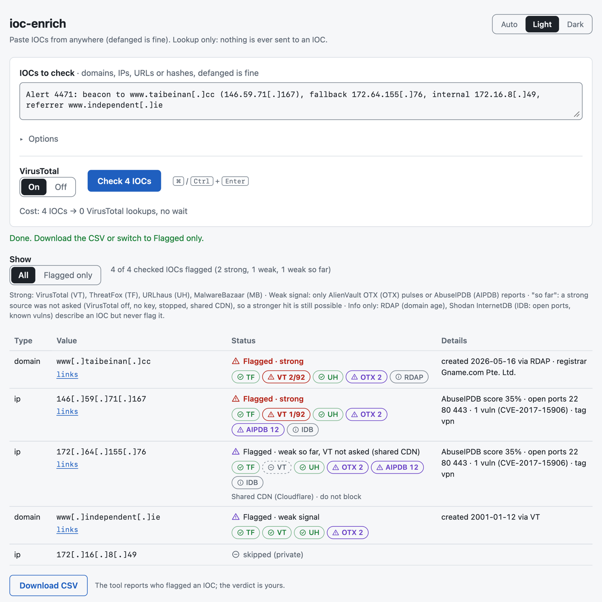

# ioc-enrich

Paste the IOCs from an alert and see what public threat-intel sources say about each one. Results come back as rows for your `iocs.csv`.


<picture>
  <source media="(prefers-color-scheme: dark)" srcset="docs/screenshot-dark.png">
  
</picture>

It runs from the command line or as a local web page, on Python 3.11+ with no third-party packages. It only looks things up: it never connects to an IOC and never submits anything for scanning.

## Quick start

```bash
git clone https://github.com/dancemonk/ioc-enrich.git && cd ioc-enrich
python3 -m venv .venv && .venv/bin/pip install -e .
source .venv/bin/activate

ioc-enrich keys     # paste your free API keys; Enter skips one
ioc-enrich serve    # open the printed http://127.0.0.1:8765/?t=... link
```

Or stay in the terminal:

```bash
pbpaste | ioc-enrich --dry-run   # what would be asked; sends nothing
pbpaste | ioc-enrich             # look it all up, write ioc-enrich-<date>.csv
```

## What it does

- Finds domains, IPv4s, URLs and MD5/SHA1/SHA256 hashes in messy text, defanged or not.
- Drops duplicates, private IPs and allowlisted domains before anything is sent. Shared CDN IPs get a "do not block" note and stay away from VirusTotal.
- Asks each source only about the types it supports, and caches answers for 7 days.
- Tells you who flagged what. The verdict is yours.
- Writes CSV rows, or merges into your existing `iocs.csv` without touching your columns.

## Sources

| Source | domain | ip | url | hash | Key |
|---|:-:|:-:|:-:|:-:|---|
| VirusTotal | ✓ | ✓ | ✓ | ✓ | free |
| ThreatFox | ✓ | ✓ | | md5, sha256 | abuse.ch |
| URLhaus | ✓ | ✓ | ✓ | md5, sha256 | abuse.ch |
| MalwareBazaar | | | | ✓ | abuse.ch |
| AlienVault OTX | ✓ | ✓ | ✓ | ✓ | free |
| AbuseIPDB | | ✓ | | | free |
| RDAP | age | | | | none |
| Shodan InternetDB | | ports, vulns | | | none |

RDAP and InternetDB add context but never flag anything.

## Keys

All keys are free and all are optional. With none you still get extraction, `--dry-run`, domain age, open ports for IPs and manual-check links for every IOC. One abuse.ch key covers three sources.

| Key | Where |
|---|---|
| `VT_API_KEY` | [virustotal.com](https://www.virustotal.com/) → your profile → API key |
| `ABUSECH_AUTH_KEY` | [auth.abuse.ch](https://auth.abuse.ch/) |
| `OTX_API_KEY` | [otx.alienvault.com](https://otx.alienvault.com/) → Settings → API key |
| `ABUSEIPDB_API_KEY` | [abuseipdb.com](https://www.abuseipdb.com/) → Account → API |

Free keys are for personal, non-commercial use. At work, use your employer's licensed keys.

## Safety

The lookup-only rule is enforced in code. `ioc_enrich/http.py` refuses any request that isn't a known lookup endpoint before a connection opens, and the tests check that, including that no DNS lookup happens during a run. Keys are never printed or logged.

VirusTotal adds every IOC you look up to its dataset, and attackers watch it. Use `--no-vt` (or the Off switch on the page) when a lookup could tip someone off.

## More

[docs/usage.md](docs/usage.md) has every command and option, the CSV format, the flagging rules, how VirusTotal quota is handled and the known limitations.

Run the tests with `.venv/bin/python -m unittest discover -s tests`. They use recorded API responses and never touch the network.

## License

MIT © Vlad Guliakin
